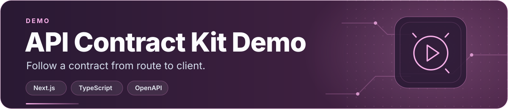

# 

A working Next.js example of API Contract Kit. Explore the geography and service-status endpoints, the typed client, and the generated OpenAPI site.

[](https://github.com/svazqz/api-contract-kit-demo/actions/workflows/deploy-openapi-pages.yml) [](https://github.com/svazqz/api-contract-kit-demo/actions/workflows/ci.yml)

[Quick start](#quick-start) · [Validation](#validation) · [Project layout](#project-layout)

## Quick start

```sh
npm ci
npm run dev
```

Open the URL printed by Next.js. The [published OpenAPI demo](https://svazqz.github.io/api-contract-kit-demo/) is also available to browse.

## Validation

```sh
npm run typecheck
npm run lint
npm run build
npm run generate:openapi
```

## Project layout

| Path | Purpose |
| --- | --- |
| [`app/`](app/) | Next.js routes, pages, and demo client |
| [`src/lib/api/`](src/lib/api/) | API definitions and schemas |
| [`scripts/generate-openapi.mjs`](scripts/generate-openapi.mjs) | Static OpenAPI export |
